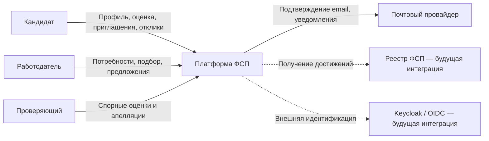
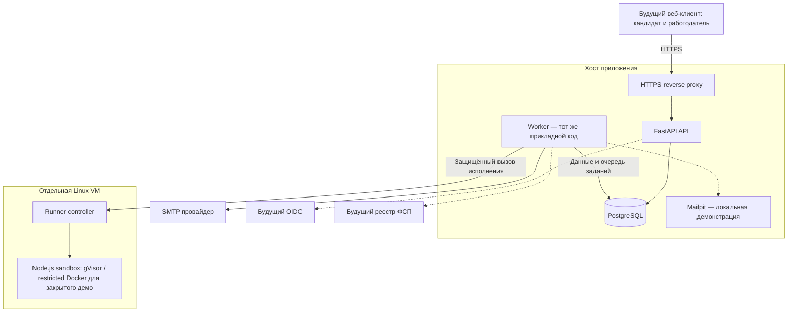
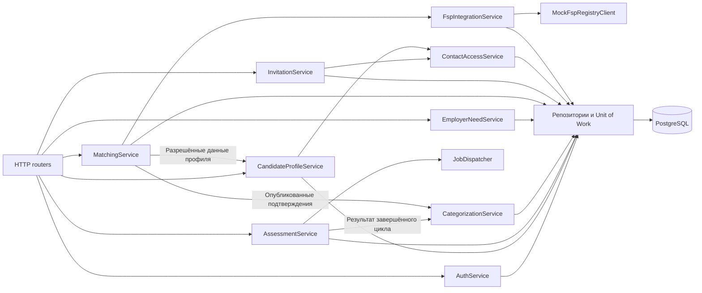

# Архитектурная спецификация платформы ФСП

## Принятые сокращения MVP

Основание: [mvp_scope.md](../mvp_scope.md). Полное оценивание — Backend Junior/Middle; frontend — справочники, концептуальный blueprint и 1–2 демонстрационных семейства без выдачи грейда. Банк: 6 backend-семейств с отдельными вариантами и рубриками уровней, всего 7–8 с frontend. Сессии: 4 кейса / 30 минут и 2 кейса / 15 минут, интервал 24–72 часа.

Единственный runtime — Node.js JavaScript. SQL и диагностика используют ограниченные структурированные ответы с объективными проверками; свободный SQL не исполняется и не проверяется только сравнением строки. HTML/CSS — демонстрационные/концептуальные материалы, без браузера и DOM. AI-режим, распознавание резюме, embeddings и advanced ML/NLP — после MVP. ФСП mock, deterministic matching и приватность сохраняются.

Подготовить **14 Markdown-документов**: архитектуру, C4, восемь ADR, доменную модель, схему PostgreSQL, API-контракт и решения по стеку.

Основание — утверждённые документы 00–04. В первый релиз включены вакансии и самостоятельные отклики. Срок — 6 дней. Исполнение кода кандидатов размещается на отдельной Linux VM; ФСП mock работает внутри монолита.

В режиме планирования файлы, миграции и код приложения не создаются.

## 1. `docs/10_architecture.md`

### Архитектурный стиль

**Модульный монолит: один репозиторий, одна прикладная модель, одна PostgreSQL, единый цикл выпуска.**

Приложение запускается в двух процессах из одного образа:

- **API:** HTTP-запросы, авторизация, пользовательские операции.
- **Worker:** подготовка вариантов тестов, проверка решений, отправка писем и служебные задания.

Изолированный runner — техническая среда исполнения, а не отдельный бизнес-сервис. Он не управляет пользователями, категориями или результатами оценки.

Этот вариант подходит для хакатона, поскольку позволяет проводить согласованные изменения в одной транзакции и не требует распределённых транзакций, брокера сообщений и независимых выпусков модулей.

### Слои

Внутри каждого модуля:

| Слой | Ответственность |
|---|---|
| `api` | Маршруты, входные и выходные модели, преобразование ошибок |
| `application` | Пользовательские операции, права, транзакции, вызовы других модулей |
| `domain` | Правила, статусы, расчёты и ограничения |
| `infrastructure` | SQLAlchemy, SMTP, HTTP-клиенты, PDF, адаптеры |

Правила зависимостей:

- Domain не зависит от FastAPI и SQLAlchemy.
- Application определяет интерфейсы внешних зависимостей.
- Infrastructure реализует эти интерфейсы.
- API вызывает application.
- Модуль изменяет только принадлежащие ему данные.
- Межмодульные операции проходят через application-интерфейсы.
- Для подборок разрешены специально выделенные read-only запросы к нескольким таблицам; они не изменяют чужие данные.

Общие инструменты — конфигурация, соединение с БД, часы, идентификаторы, ошибки и аудит. Общая папка не становится местом хранения бизнес-логики.

### Модули

| Модуль | Владеет |
|---|---|
| `auth` | Учётные записи, локальные пароли, идентичности, сессии, подтверждение email |
| `catalog` | Специализации, грейды, категории, навыки и технологии |
| `candidate_profile` | Профиль, контакты, предпочтения, согласия и блокировки работодателей |
| `assessment` | Опросники, банк, blueprint, циклы, попытки, ответы, проверка и спорные случаи |
| `categorization` | Подтверждённые навыки и опубликованные категории |
| `employer` | Профиль компании и потребности |
| `matching` | Фильтры, расчёт, объяснения и снимки подборок |
| `invitation` | Предложения и переходы их статусов |
| `vacancy` | Публикация, изменение и закрытие вакансий |
| `application` | Самостоятельные отклики и их статусы |
| `fsp` | Привязка ФСП ID, получение достижений и происхождение данных |
| `notifications` | Подготовка и доставка уведомлений |

Разрешения на контакты принадлежат `candidate_profile`. Модули приглашений и откликов создают их через внутренний интерфейс в общей транзакции.

### Основные потоки данных

**Регистрация**

API → Auth → User и одноразовое подтверждение → задание отправки письма → Worker → SMTP.

**Оценка**

Профиль и опрос → AssessmentCycle → подготовленные формы A/B → TestAttempt → зафиксированные ответы → Worker → runner → проверка доверенным оценщиком → результат.

**Категоризация**

Завершённый цикл → проверка достаточности доказательств и cooldown → публикация SkillEvidence и CategoryConfirmation в одной транзакции.

**Подбор**

EmployerNeed → доступные опубликованные категории → фильтры → scoring → объяснения → RecommendationBatch с версией потребности и временем расчёта.

**Приглашение**

Выбор кандидата → повторная проверка условий → Invitation → принятие → ContactGrant.

**Самостоятельный отклик**

Опубликованная Vacancy → Application и явное согласие кандидата → ContactGrant в той же транзакции.

### Транзакции и конкуренция

Одна application-операция использует один Unit of Work и одну `AsyncSession`. Сессии не разделяются между параллельными задачами: это соответствует модели использования [SQLAlchemy asyncio](https://docs.sqlalchemy.org/en/20/orm/extensions/asyncio.html).

Атомарными должны быть:

- Принятие приглашения и создание доступа к контактам.
- Создание отклика и соответствующего разрешения.
- Публикация категории и доказательств навыков.
- Фиксация ответа и постановка задания на проверку.
- Регистрация и постановка задания на отправку подтверждения.

Для конкурентных переходов использовать блокировку изменяемой строки либо условное обновление по версии. Принятие и отзыв одного приглашения не могут одновременно завершиться успешно.

Сетевые вызовы SMTP и runner выполняются вне длительной транзакции.

### Минимальные сохраняемые фоновые задания

Использовать PostgreSQL-таблицу `background_jobs`:

- Постановка задания вместе с бизнес-изменением.
- Получение worker через блокировку с `SKIP LOCKED`.
- Один worker; статусы queued/running/succeeded/failed, число попыток и время следующего запуска. Метка истечения обработки позволяет вернуть зависшее задание в очередь после сбоя; распределённый менеджер leases не нужен.
- Повторяемые обработчики и уникальный ключ задания.
- Восстановление после остановки worker.

Проверку решений нельзя поручать только `FastAPI BackgroundTasks`: для неё нужна сохраняемая очередь и восстановление после сбоя. Возможности встроенного механизма описаны в [документации FastAPI](https://fastapi.tiangolo.com/tutorial/background-tasks/).

Redis и Celery в первом релизе не требуются. Не нужны приоритеты очередей, автоскейлинг и сложная оркестрация. Атомарный захват, ограниченные retries, восстановление и идемпотентная запись результата остаются обязательными даже при одном worker.

### Исполнение кода

На отдельной Linux VM:

- Небольшой технический runner-controller.
- Одноразовые контейнеры Node.js JavaScript; `runsc`/gVisor предпочтителен. Резерв — restricted Docker на выделенной VM только для закрытого демо. Это не эквивалентная защита для публичного исполнения недоверенного кода.
- Нет маршрута к PostgreSQL и секретам приложения.
- Нет Docker socket внутри API и контейнера кандидата.
- Сеть задачи отключена; запрещён privileged-режим, сброшены capabilities, включён no-new-privileges, используется непривилегированный пользователь. Корень read-only, запись только во временную область; seccomp не отключается, файловые системы хоста не монтируются.
- Временная файловая система очищается после запуска.
- Ограничены CPU, память, процессы, объём ввода и вывода.
- Образы и параметры исполнения выбираются сервером из разрешённого списка.

API и worker обращаются к контроллеру по защищённому внутреннему соединению с взаимной аутентификацией. Контроллер возвращает результат исполнения, но не выставляет грейд.

Эталонные ответы и логика выставления балла остаются у доверенного оценщика. Они не размещаются рядом с кодом кандидата.

Для шестидневного релиза исполняемый язык — **JavaScript в Node.js 24 LTS**. SQL, HTML/CSS и часть диагностических задач могут использовать структурированные ответы. Полноценные произвольные веб-приложения не разворачиваются.

Интеграция Docker с `runsc` предусмотрена [документацией gVisor](https://gvisor.dev/docs/user_guide/quick_start/docker/); Node.js 24 относится к LTS-веткам по [официальному расписанию](https://nodejs.org/en/about/previous-releases).

Недоступность runner означает техническую ошибку или ожидание проверки, а не неправильный ответ кандидата.

### Security model

- Пароли: Argon2id через `pwdlib`.
- Access JWT: срок 15 минут, фиксированный разрешённый алгоритм, проверка `iss`, `aud`, `exp`, `sub`, `sid`.
- Refresh token: случайный непрозрачный токен, срок 7 дней, хранение хеша, ротация.
- Повторное использование заменённого refresh token отзывает его сессию.
- Статус пользователя и сессии проверяется сервером; logout прекращает дальнейшее использование сессии.
- Подтверждение email и восстановление пароля используют одноразовые токены с ограниченным сроком.
- Лимиты запросов применяются к входу, восстановлению, выдаче токенов и отправке приглашений.
- Публичная регистрация допускает только `candidate` и `employer`.
- Ограниченная служебная роль `staff` создаётся административно для рассмотрения спорных попыток; отдельный кабинет не нужен.

Связка `pwdlib` и `PyJWT` поддерживается рекомендациями [FastAPI по аутентификации](https://fastapi.tiangolo.com/tutorial/security/oauth2-jwt/).

Для будущего браузера:

- Access token хранится в памяти клиента.
- Refresh — в `HttpOnly`, `Secure`, `SameSite` cookie.
- Cookie-аутентифицируемые операции защищены CSRF-проверкой.
- Разрешённые origins перечислены явно.
- Основной вариант развёртывания — клиент и API под одним origin.

### Совместимость с OIDC

Ввести внутреннюю идентичность:

**`issuer + subject → internal User.id`.**

Локальная авторизация и будущая OIDC-авторизация возвращают одинаковый прикладной `Principal`.

Будущий Keycloak подключается через Authorization Code + PKCE. Его идентификатор хранится в `user_identities`; внутренние User ID и связи профилей сохраняются.

Не связывать аккаунты автоматически только по совпадению email. Связь требует подтверждения владельца действующего аккаунта.

JWT сам по себе не делает систему OIDC-провайдером; приложение остаётся клиентом будущего провайдера. Основание — [OpenID Connect Core](https://openid.net/specs/openid-connect-core-1_0.html).

### Privacy model

- Контакты хранятся отдельно от публичной части профиля.
- Выходные модели карточки и контактов разделены.
- ORM-объекты не сериализуются напрямую.
- Доступ к контактам проверяется при каждом запросе.
- Источники разрешения: принятое приглашение или самостоятельный отклик.
- Разрешение связано с конкретными кандидатом и работодателем.
- Несколько действующих источников могут давать доступ; отзыв одного не отменяет другое действующее согласие.
- Действие «закрыть контакты работодателю» отзывает все разрешения этой пары.
- Отзыв не меняет исторические статусы приглашений.
- Снимки подборок не содержат контактов и не обходят текущие настройки видимости.

Согласия фиксируются с версией текста, временем и источником в разрешениях и аудите.

### Ошибки и наблюдаемость

Единый формат ошибок на основе Problem Details: `type`, `title`, `status`, `detail`, `code`, `request_id`, безопасные сведения о полях. Основание: [RFC 9457](https://www.rfc-editor.org/rfc/rfc9457.html).

Основные ответы:

- `401` — нет действующей аутентификации.
- `403` — операция запрещена.
- `404` — объект отсутствует или недоступен по принадлежности.
- `409` — конфликт версии, состояния, cooldown или повторной операции с другим содержимым.
- `422` — некорректные входные данные.
- `429` — превышен лимит.
- `503` — временно недоступна необходимая зависимость.

Минимум observability:

- Структурированные JSON-логи.
- `request_id` и `job_id`.
- Длительность запросов, подбора и проверки решений.
- Размер очереди, число повторов и технических ошибок.
- Аудит категорий, приглашений, согласий и служебных решений.
- `/health/live` и `/health/ready`.

Пароли, токены, контакты, исходный код решений и эталоны в обычные логи не попадают.

## 2. `docs/11_c4_diagrams.md`

Использовать Mermaid с явным обозначением границ системы и будущих компонентов.

### C4 Level 1 — System Context

### C4 Level 2 — Container

Внутренний `MockFspRegistryClient` является компонентом монолита и не изображается отдельным контейнером.

### C4 Level 3 — ключевые компоненты

Дополнить диаграмму таблицей интерфейсов:

| Компонент | Основные интерфейсы |
|---|---|
| Auth | Аутентификация, Principal, управление сессиями |
| Candidate profile | Свой профиль, безопасная карточка, предпочтения, контакты |
| Assessment | Начало цикла и сессии, сохранение ответа, финальная отправка, результат |
| Categorization | Публикация и получение подтверждений |
| Employer need | Создание и версионирование потребности |
| Matching | Построение и чтение снимка подборки |
| Invitation | Отправка, просмотр, принятие, отказ, отзыв |
| FSP adapter | Поиск участника, проверка привязки, получение достижений |

## 3. `docs/adr/`

Каждый ADR содержит: контекст, решение, альтернативы, последствия, ограничения и связанные документы. На стадии проектирования статус — `Proposed`.

| Файл | Решение |
|---|---|
| `ADR-001-modular-monolith.md` | Один прикладной монолит и БД; API и worker — процессы одного приложения; runner выделен по границе безопасности |
| `ADR-002-python-api-stack.md` | FastAPI, PostgreSQL, SQLAlchemy 2.0 и Alembic; транзакционные операции и типизированные контракты |
| `ADR-003-auth-and-oidc.md` | Локальные email/password и JWT сейчас; отдельная модель идентичностей для будущего OIDC |
| `ADR-004-parameterized-assessment.md` | Версионируемый проверенный банк, структурные варианты и параметры; отсутствие runtime LLM-генерации зачётных заданий |
| `ADR-005-deterministic-matching.md` | Фильтры, фиксированные веса, объяснения и снимки; embeddings допускаются позднее после сравнительной валидации |
| `ADR-006-fsp-registry-client.md` | Внутренний mock через интерфейс реестра; будущий HTTP-клиент не меняет бизнес-модули |
| `ADR-007-mandatory-salary.md` | Диапазон RUB обязателен для вакансий и приглашений, проверяется API и БД; отправленные условия неизменяемы |
| `ADR-008-contact-visibility.md` | Отдельные разрешения на контакты; принятие и отклик создают доступ атомарно, отзыв закрывает будущие обращения |

ADR-005 отдельно фиксирует: будущие embeddings не обходят hard filters, приватность и требования к подтверждённой категории.

ADR-006 указывает, что внутренний контракт клиента — наша модель интеграции, а не описание ещё не предоставленного API ФСП.

## 4. `docs/12_domain_model.md`

### Запрошенные сущности

| Сущность | Назначение и связи |
|---|---|
| `User` | Учётная запись; локальные и внешние идентичности; профиль кандидата либо работодателя |
| `CandidateProfile` | Профиль, предпочтения и настройки видимости; связан с контактами, оценками и подтверждениями |
| `EmployerProfile` | Компания и её представитель; владелец потребностей, вакансий и приглашений |
| `Specialization` | Направление деятельности |
| `Grade` | Поддерживаемый уровень |
| `Category` | Уникальная пара Specialization + Grade |
| `Questionnaire` | Версионированные ответы кандидата и выбранный предполагаемый уровень |
| `TestBlueprint` | Версия состава оценки для категории и режима |
| `TestItem` | Версия задания внутри семейства с параметризацией и рубрикой |
| `TestAttempt` | Одна сессия A или B внутри полного цикла |
| `TestAttemptItem` | Зафиксированный вариант задания конкретной попытки |
| `EmployerNeed` | Структурированная потребность с версией |
| `CandidateRecommendation` | Позиция кандидата в конкретном снимке подборки |
| `Invitation` | Неизменяемые условия предложения и состояние взаимодействия |
| `Vacancy` | Опубликованная или закрытая вакансия работодателя |
| `Application` | Отклик кандидата с копией условий вакансии на момент подачи |
| `FspAchievementMock` | Демонстрационная запись, преобразуемая адаптером в достижение с `source=mock` |

### Необходимые дополнительные сущности

- `UserIdentity` — связь `issuer + subject` с User.
- `AuthSession` — обновление и отзыв авторизации.
- `CandidateContact` — отдельная закрытая часть профиля.
- `AssessmentCycle` — полный процесс оценки из двух сессий.
- `TestItemFamily` — единица независимости доказательства.
- `TestSubmission` — зафиксированный ответ этапа.
- `SkillEvidence` — результат по навыку с источником и условиями.
- `CategoryConfirmation` — опубликованное подтверждение грейда.
- `AssessmentReview` — спорная попытка и решение проверяющего.
- `RecommendationBatch` — снимок потребности и результатов расчёта.
- `ContactGrant` — конкретное согласие на доступ к выбранным контактам.
- `FspLink` — привязка участника и её статус.
- `FspAchievement` — нормализованное достижение с происхождением.
- `BackgroundJob` и `AuditEvent` — доставка заданий и аудит.

### Основные инварианты

- Заявленный грейд не является CategoryConfirmation.
- Сессии A и B не являются двумя независимыми полноценными циклами.
- Несколько параметризаций одного семейства не увеличивают число независимых доказательств.
- Исторические задания, ответы, результаты и предложения не переписываются.
- В одной специализации у кандидата только одно действующее опубликованное подтверждение; история сохраняется.
- Рекомендация не даёт доступа к контактам.
- Достижение mock не превращается в настоящее подтверждение реестра.
- Application открывает контакты по согласию кандидата при подаче, а не после решения работодателя.

Статусы вакансии: `published`, `closed`.

Статусы отклика: `submitted`, `viewed`, `accepted`, `rejected`, `withdrawn`. Отзыв отклика отзывает разрешение, созданное этим откликом; другие действующие согласия сохраняются.

## 5. `docs/13_database_schema.md`

### Общие соглашения

- Идентификаторы — UUID.
- Время — `timestamptz`, хранение в UTC.
- Зарплаты — `numeric(12,2)`, без float.
- Баллы — Decimal/numeric.
- Изменяемые объекты имеют `version`.
- Статусы — строки с `CHECK`, чтобы не усложнять изменение PostgreSQL ENUM.
- Справочники деактивируются, а не удаляются при наличии исторических ссылок.
- Авторитетные связи и ограничения — в реляционных колонках.
- JSONB используется для версионированного содержимого, снимков и составных ответов.

### Таблицы и основные поля

| Таблица | Основные поля сверх `id` |
|---|---|
| `users` | `email_normalized`, `password_hash`, `role`, `status`, `email_verified_at`, `created_at` |
| `user_identities` | `user_id`, `issuer`, `subject`, `linked_at` |
| `auth_sessions` | `user_id`, `refresh_token_hash`, `expires_at`, `revoked_at`, `rotation_version` |
| `auth_action_tokens` | `user_id`, `purpose`, `token_hash`, `expires_at`, `used_at` |
| `candidate_profiles` | `user_id`, `display_name`, `summary`, `experience`, `salary_min`, `salary_max`, `salary_basis`, `available_from`, `preferences_confirmed_at`, `privacy`, `work_preferences`, `consent_version`, `consented_at`, `version` |
| `candidate_contacts` | `candidate_id`, `email`, `phone`, `messengers`, `updated_at` |
| `employer_profiles` | `user_id`, `company_name`, `description`, `industry`, `representative_contact`, `status`, `version` |
| `candidate_employer_blocks` | `candidate_id`, `employer_id`, `created_at` |
| `specializations` | `code`, `name`, `active` |
| `grades` | `code`, `name`, `sort_order`, `active` |
| `categories` | `specialization_id`, `grade_id` |
| `skills` | `code`, `specialization_id`, `name`, `active` |
| `technologies` | `code`, `name`, `aliases`, `active` |
| `candidate_technologies` | `candidate_id`, `technology_id`, `declared`, `evidence_id` |
| `questionnaires` | `candidate_id`, `schema_version`, `answers`, `specialization_id`, `declared_grade_id`, `submitted_at` |
| `test_blueprints` | `category_id`, `mode`, `version`, `definition`, `status`, `published_at` |
| `test_item_families` | `code`, `specialization_id`, `status`, `exposure_metadata` |
| `test_items` | `family_id`, `version`, `category_id`, `mode`, `public_definition`, `parameter_schema`, `private_grading_definition`, `generator_key`, `checker_key`, `runtime_key`, `status` |
| `assessment_cycles` | `candidate_id`, `category_id`, `questionnaire_id`, `blueprint_id`, `mode`, `status`, `policy_version`, `started_at`, `completed_at` |
| `test_attempts` | `cycle_id`, `phase`, `status`, `available_from`, `started_at`, `deadline_at`, `submitted_at`, `graded_at` |
| `test_attempt_items` | `attempt_id`, `test_item_id`, `family_id`, `position`, `seed`, `public_snapshot`, `private_snapshot`, `draft_answer`, `stage`, `version` |
| `test_submissions` | `attempt_item_id`, `stage`, `answer`, `answer_hash`, `submitted_at`, `grading_status`, `grading_result`, `grader_version` |
| `skill_evidence` | `candidate_id`, `cycle_id`, `submission_id`, `skill_id`, `family_id`, `mode`, `rubric_score`, `assessment_version`, `assessed_at` |
| `category_confirmations` | `candidate_id`, `category_id`, `specialization_id`, `cycle_id`, `status`, `published_at`, `superseded_at` |
| `assessment_reviews` | `cycle_id`, `status`, `reason_codes`, `reviewer_id`, `decision`, `decision_reason`, `resolved_at` |
| `employer_needs` | `employer_id`, `specialization_id`, `title`, `role`, `salary_from`, `salary_to`, `currency`, `salary_basis`, `team_description`, `task_description`, `urgency`, `desired_start_date`, `start_date_required`, `work_preferences`, `additional_requirements`, `status`, `version` |
| `employer_need_categories` | `need_id`, `category_id` |
| `employer_need_technologies` | `need_id`, `technology_id`, `requirement_kind`, `verification_required` |
| `employer_need_skills` | `need_id`, `skill_id`, `priority`, `required` |
| `recommendation_batches` | `need_id`, `employer_id`, `need_version`, `need_snapshot`, `scoring_version`, `as_of`, `created_at` |
| `candidate_recommendations` | `batch_id`, `candidate_id`, `confirmation_id`, `category_id`, `compatibility_group`, `score`, `rank`, `components`, `explanations`, `profile_version` |
| `invitations` | `employer_id`, `candidate_id`, `need_id`, `vacancy_id`, `salary_from`, `salary_to`, `currency`, `salary_basis`, `offer_snapshot`, `status`, `sent_at`, `viewed_at`, `expires_at`, `decided_at`, `version` |
| `vacancies` | `employer_id`, `need_id`, `title`, `description`, `salary_from`, `salary_to`, `currency`, `salary_basis`, `conditions`, `status`, `published_at`, `closed_at`, `version` |
| `applications` | `vacancy_id`, `candidate_id`, `employer_id`, `vacancy_snapshot`, `message`, `status`, `submitted_at`, `updated_at`, `version` |
| `contact_grants` | `candidate_id`, `employer_id`, `invitation_id`, `application_id`, `allowed_fields`, `consent_version`, `granted_at`, `revoked_at` |
| `fsp_links` | `candidate_id`, `external_subject`, `source`, `binding_status`, `linked_at`, `synced_at`, `last_error_code` |
| `fsp_achievements` | `link_id`, `external_id`, `source`, `title`, `event_date`, `result`, `verification_status`, `source_version`, `synced_at` |
| `background_jobs` | `kind`, `payload`, `deduplication_key`, `status`, `attempt_count`, `available_at`, `lease_until`, `last_error_code` |
| `idempotency_records` | `actor_id`, `operation`, `key`, `request_hash`, `result_reference`, `created_at`, `expires_at` |
| `audit_events` | `actor_id`, `action`, `entity_type`, `entity_id`, `request_id`, `safe_metadata`, `created_at` |

JSONB-поля перечисляются в документе явно: определения, параметры, ответы, результаты рубрик, предпочтения, снимки и объяснения.

Пароли и refresh token не хранятся в исходном виде. Если для доставки письма в очереди требуется одноразовая ссылка, её чувствительная часть хранится зашифрованной и удаляется после доставки; ключ находится вне БД и репозитория.

### Ключевые ограничения

- Unique: нормализованный email.
- Unique: `(issuer, subject)`.
- Unique: `user_id` в каждом ролевом профиле.
- Unique: `(specialization_id, grade_id)`.
- Unique: версия blueprint и версия задания в своей серии.
- Unique: `(cycle_id, phase)`.
- Unique: `(attempt_id, position)`.
- Unique: финальная отправка одного этапа задания.
- Частичный unique: одно действующее подтверждение кандидата в специализации.
- Unique: кандидат в одном снимке подборки.
- Частичный unique: одна пара приглашения по работодателю, потребности и кандидату со статусом `sent`, `viewed` или `accepted`.
- Unique: один отклик кандидата на вакансию в первом релизе.
- ContactGrant ссылается ровно на один источник: Invitation либо Application.
- Зарплаты конечные, положительные, верхняя граница не меньше нижней.
- Для приглашений и вакансий обе границы обязательны.
- Рубрика ограничена диапазоном 0–4; итоговый рейтинг — 0–100.
- Составные FK или транзакционная проверка обеспечивают соответствие владельца потребности, вакансии, приглашения и отклика.
- Кандидат доказательства должен совпадать с владельцем цикла оценки.

В частичных индексах не использовать условие с текущим временем. Просроченные приглашения приводятся к конечному состоянию перед созданием нового; принятие всегда отдельно проверяет `expires_at`.

### Индексы

- Внешние ключи, участвующие в поиске и соединениях.
- Подтверждения: `(category_id, candidate_id)` для действующих записей.
- Технологии кандидата: `(technology_id, candidate_id)`.
- Приглашения: `(candidate_id, status, sent_at)` и `(employer_id, status, sent_at)`.
- Отклики: `(vacancy_id, status, submitted_at)`.
- Рекомендации: `(batch_id, category_id, compatibility_group, rank)`.
- Циклы: `(candidate_id, specialization/category, started_at)`.
- Задания worker: `(status, available_at)`.
- Разрешения: `(candidate_id, employer_id)` для неотозванных.
- GIN — только для JSONB-полей, по которым действительно выполняются фильтры; ответы и снимки не индексируются целиком без необходимости.

## 6. `docs/14_api_contract.md`

### Общие правила

- Префикс: `/api/v1`.
- JSON, UTC-время в ISO 8601.
- Денежные значения передаются десятичными строками, валюта — RUB.
- Версионируемые изменения используют `version`; конфликт возвращает `409`.
- Создание значимых ресурсов поддерживает `Idempotency-Key`.
- Повтор ключа с другим содержимым — `409`.
- Ответы по idempotency не обходят текущую авторизацию.
- Списки используют ограничение размера и курсор.
- Длительные операции возвращают `202` и идентификатор ресурса для опроса.
- Пользователь не передаёт доверенные `owner_id`, баллы, грейды, статусы проверки или автора аудита.

Для каждого endpoint в документе зафиксировать роль, обязательные поля, ответ, ошибки и побочный эффект.

### Endpoint-группы

| Группа | Основные endpoints |
|---|---|
| Auth | `POST /auth/register`, `/auth/login`, `/auth/refresh`, `/auth/logout`, `/auth/verify-email`, `/auth/resend-verification`, `/auth/password-reset/request`, `/auth/password-reset/confirm`; `GET /auth/me` |
| Профиль кандидата | `GET/PATCH /candidate/profile`, `GET/PATCH /candidate/contacts`, `PATCH /candidate/privacy`, `GET /candidate/profile.pdf` |
| Профиль работодателя | `GET/PATCH /employer/profile` |
| Справочники | `GET /catalog/specializations`, `/grades`, `/categories`, `/skills`, `/technologies` |
| Опрос | `GET /questionnaires/schema`, `POST /questionnaires`, `GET /questionnaires/me` |
| Assessment | `POST /assessment/cycles`, `GET /assessment/cycles/{id}`, `POST /assessment/cycles/{id}/attempts/{phase}/start`, `GET /assessment/attempts/{id}`, `PUT /assessment/attempt-items/{id}/draft`, `POST /assessment/attempt-items/{id}/submit`, `POST /assessment/attempts/{id}/finish` |
| Результаты и категории | `GET /assessment/cycles/{id}/result`, `GET /candidate/categories`, `GET /candidate/skill-evidence` |
| Спорные оценки | `POST /assessment/cycles/{id}/appeal`; служебные `GET /assessment/reviews`, `POST /assessment/reviews/{id}/decision` |
| Потребности | `POST/GET /employer/needs`, `GET/PATCH /employer/needs/{id}`, `POST /employer/needs/{id}/archive` |
| Подбор | `POST /employer/needs/{id}/recommendations`, `GET /employer/needs/{id}/recommendation-batches`, `GET /recommendation-batches/{id}` |
| Карточки кандидатов | `GET /candidates/{id}/card`, `GET /candidates/{id}/contacts` |
| Приглашения | `POST/GET /invitations`, `GET /invitations/{id}`, `POST /invitations/{id}/view`, `/accept`, `/reject`, `/withdraw` |
| Вакансии | `POST /employer/vacancies`, `PATCH /employer/vacancies/{id}`, `POST /employer/vacancies/{id}/close`, `GET /vacancies`, `GET /vacancies/{id}` |
| Отклики | `POST /vacancies/{id}/applications`, `GET /candidate/applications`, `GET /employer/vacancies/{id}/applications`, `POST /applications/{id}/view`, `/accept`, `/reject`, `/withdraw` |
| Разрешения | `GET /candidate/contact-grants`, `POST /candidate/contact-grants/{id}/revoke`, `POST /candidate/employers/{id}/revoke-contact-access` |
| ФСП | `POST /candidate/fsp/link`, `DELETE /candidate/fsp/link`, `POST /candidate/fsp/sync`, `GET /candidate/fsp/achievements` |
| ФСП mock | Служебный `GET /internal/fsp-mock/participants/{id}`, доступный только в demo-конфигурации |
| Состояние | `/health/live`, `/health/ready` |

### Основные контракты

**Assessment**

Создание цикла принимает выбранную категорию, режим и опросник. Возвращает цикл со статусом подготовки.

Отправка ответа принимает текущий этап, формат ответа, содержимое и версию. После финальной отправки этап неизменяем.

Ответы клиенту не содержат seed, эталоны, скрытые тесты, закрытые этапы и внутренние признаки антифрода.

**Рекомендации**

Возвращаются:

- Идентификатор снимка.
- Версия потребности и формулы.
- Время расчёта.
- Группы по категориям и известности условий.
- Разрешённые карточки кандидатов.
- Баллы, безопасные составляющие и объяснения.

Если кандидат перестал быть доступен, возвращается нейтральная отметка недоступности, а не сохранённые закрытые сведения.

**Приглашение**

Создание требует кандидата, потребности, описания предложения, зарплаты, условий и способа связи работодателя.

Принятие принимает перечень разрешённых контактных полей и версию согласия. Проверяются срок, состояние и принадлежность приглашения. В одной транзакции создаётся ContactGrant.

**Отклик**

Создание требует опубликованной вакансии, выбранных контактных полей и согласия. Зарплата и условия копируются из вакансии, а не принимаются произвольными от кандидата.

**ФСП**

Привязка принимает внешний идентификатор и доказательство владения, предусмотренное адаптером. Для mock используются демонстрационные подтверждения из fixtures; знание чужого ФСП ID не даёт права привязать его.

Синхронизация возвращает статус операции. «Нет достижений», «участник не найден» и «временная ошибка» различаются.

### Будущий OIDC

Зарезервировать описание входа и привязки внешнего провайдера, но не реализовывать его endpoints в первом релизе. Локальный `/auth/login` не представляется как реализация OIDC.

## 7. `docs/15_stack_decisions.md`

| Компонент | Решение |
|---|---|
| Python | **3.14**, обычная CPython-сборка |
| FastAPI | Стабильный релиз с поддержкой Pydantic v2 |
| Pydantic | **v2**, минимум ветка с поддержкой Python 3.14; отдельные модели входа и ответа |
| PostgreSQL | **17**, актуальный patch-релиз этой ветки |
| SQLAlchemy | **2.0.x**, async ORM, типизированные модели |
| Alembic | **1.x**, единая история миграций |
| asyncpg | **0.31.x**, драйвер PostgreSQL |
| ASGI | Uvicorn |
| Упаковка | Docker, Docker Compose plugin с командой `docker compose` |
| Зависимости | `pyproject.toml` и `uv.lock`, фиксированные версии для API и worker |
| Тесты | pytest, pytest-asyncio, HTTPX, настоящая PostgreSQL для интеграционных проверок |
| Стиль | Ruff: lint и format |
| Типы | mypy; строгая проверка domain/application |
| Auth | `pwdlib[argon2]`, `PyJWT[crypto]` |
| Внешние вызовы | HTTPX с тайм-аутами |
| PDF | ReportLab и встроенный шрифт с поддержкой кириллицы |
| Локальная почта | Mailpit |
| Runner | Выделенная Linux VM, Node.js 24 LTS; gVisor предпочтителен, restricted Docker — резерв закрытого демо |
| pgvector | Не устанавливается в первом релизе |
| Redis | Не устанавливается в первом релизе |
| Background tasks | Сохраняемая очередь PostgreSQL и worker обязательны для исполнения кода |

Python 3.14 находится в поддерживаемой ветке; asyncpg публикует сборки для неё. PostgreSQL 17 также поддерживается. Источники: [Python](https://devguide.python.org/versions/), [asyncpg](https://pypi.org/project/asyncpg/), [PostgreSQL](https://www.postgresql.org/support/versioning/).

Конкретные patch-версии фиксируются при первом воспроизводимом разрешении зависимостей и проверке сборки. Сейчас не заявляется, что совместимость набора уже проверена запуском.

Миграции в будущем выполняются отдельным шагом выпуска, а не каждым API-процессом при старте. Alembic поддерживает работу с asyncio-окружением через соответствующую организацию migration environment: [документация Alembic](https://alembic.sqlalchemy.org/en/latest/cookbook.html#using-asyncio-with-alembic).

## 8. План на 6 дней и проверка согласованности документов

Этот раздел включить в архитектуру как план реализации, а не обещание готовности всей целевой системы.

| День | Основной результат |
|---|---|
| 1 | Каркас модулей, согласованная схема, auth, окружение и проверка доступности изолированного runner |
| 2 | Профили, приватность, справочники, ФСП mock, импорт проверенного банка и подготовка циклов |
| 3 | Отправка и проверка решений, результаты, категории и история; начало пилотных прохождений |
| 4 | Потребности, подборки, объяснения, приглашения и атомарная выдача контактов |
| 5 | Вакансии, отклики, PDF, проверки конкуренции и доступа |
| 6 | Контрольная валидация, исправление блокирующих дефектов, документация и демонстрация |

Распределение ответственности:

- Auth, профили, приватность, приглашения и отклики.
- Assessment, runner, категоризация.
- Подбор, ФСП, данные валидации и интеграционные проверки.

Разработчик A отвечает за auth, профили, приватность, frontend, приглашения, вакансии и отклики; B — за assessment, runner, категоризацию, подбор и FSP mock. Разработчика C и выделенных экспертов нет. График и резерв времени — в `06_plan.md`.

### Проверки перед утверждением комплекта документов

- Все сущности API имеют владельца-модуль и место хранения.
- Все FK, статусы и значения зарплаты согласованы между документами.
- Две сессии оценки не сведены к одной таблице без AssessmentCycle.
- Ответы, задания и методики воспроизводимы по сохранённым версиям.
- Контакты нельзя получить через рекомендации, PDF или историю.
- Принятие, отзыв и истечение приглашения корректны при конкуренции.
- Отклик выдаёт только явно разрешённый доступ.
- Worker восстанавливается после остановки без повторной публикации результатов.
- Ошибка runner не превращается в провал кандидата.
- Mock-достижения обозначены как демонстрационные.
- Переход к OIDC сохраняет внутренние идентификаторы пользователей.
- Redis, pgvector и runtime LLM не являются скрытыми обязательными зависимостями.
- C4 показывает один прикладной монолит, а граница исполнения недоверенного кода выделена явно.
- Никакие тесты, миграции, endpoints или production-возможности не объявлены реализованными в архитектурных документах.
